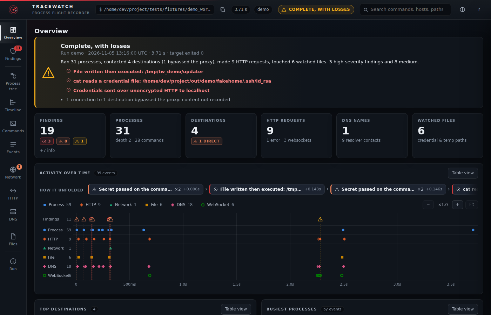
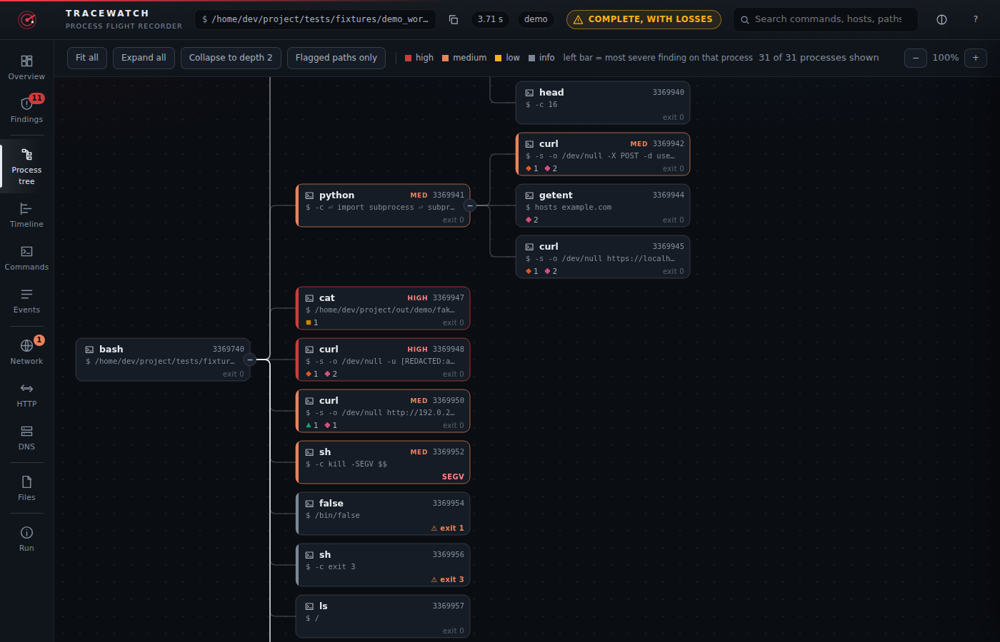
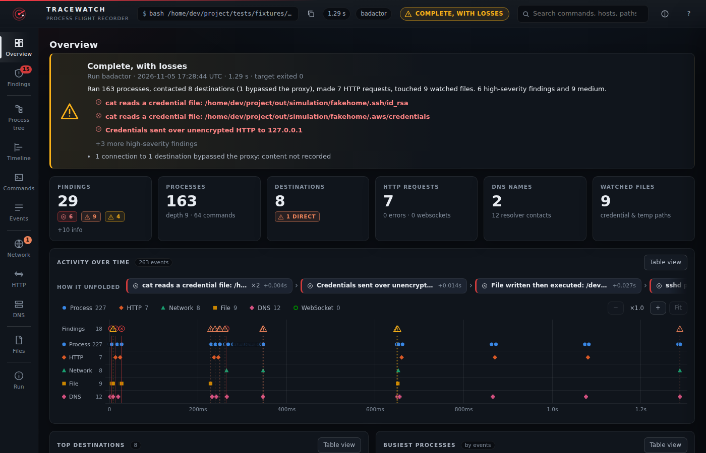

# tracewatch

An experiment: run a command under a Linux process tracer and an intercepting HTTPS proxy, then turn what
happened into a report you can read, click around in, or diff against another run.

It started as a way to play with [Tracee](https://github.com/aquasecurity/tracee) (eBPF process tracing) and
[mitmproxy](https://mitmproxy.org/), and to see how far a coding assistant could take that. It was built together with
Claude. It is a toy-sized "flight recorder", not a security product: nothing here has been hardened,
audited, or tested beyond the scenarios in this repository.

## Live demo

Interactive example reports (real output from example runs, with paths, names and IP addresses replaced):
**https://andrewbrooks.github.io/tracewatch/**. The simulated-intruder report is the best place to start.

## Screenshots

From the scripted demo workload (`tests/fixtures/demo.sh`). Machine-specific paths, user and host names and IP
addresses were replaced before rendering (`tests/browser/screenshots.py`).



| | |
|---|---|
|  |  |

## What it does

```
tracewatch record -- <command> [args...]     # run it; recording ends when the command exits
tracewatch report <run-dir>                  # interactive HTML report (default), or --format md | json
tracewatch diff <run-a> <run-b>              # what behaved differently? (--format md | json | html)
tracewatch verify <run-dir>                  # what can be trusted in this recording?
tracewatch sweep                             # clean up after a recorder that died
```

For the command you launch (and everything it starts) it records:

- the **process tree**: who started whom, with full command lines and exit codes
- **network activity**: HTTP(S) requests and responses through the proxy (including HTTP/2 and websockets),
  which process sent each one, DNS lookups the proxy performed, and TCP connections that bypassed the proxy
- **file activity** for a short watch list (credential stores, temp directories), not every file open, and the
  **contents of the files the process created or wrote** there (inert, size-capped, secrets redacted; files it only
  read are never captured)
- 24 rule-based **findings** (e.g. "wrote a file, then executed it", "credential sent over plain HTTP"),
  each pointing at the events that triggered it. Every rule has an entry in a built-in dictionary (what it means, what it
  cannot tell you, what benign activity looks the same, and whether it has ever fired on a real recording), shown in the
  report. The severities are rough heuristics, not measurements

The interactive report is a single self-contained HTML file (no network access, dark and light themes, keyboard
navigation, prints reasonably). The Markdown report is the same information as a flat file.

## Requirements

- Linux. It was developed and tested on **WSL2 with Docker Desktop**; plain Linux with Docker should work but has
  not been exercised as much.
- Python 3.12+ and [uv](https://docs.astral.sh/uv/)
- Docker that can run a privileged container (Tracee runs as `aquasec/tracee:0.24.1`, the only version it has been tested with)
- `setpriv` (util-linux) and `curl` (used by the demo and tests)

Tracee runs as a **privileged container with host PID access**. Only run this on a machine where that is acceptable.

## Quick start

```
git clone https://github.com/andrewbrooks/tracewatch.git && cd tracewatch
uv sync
.venv/bin/tracewatch record --out out/runs --name hello -- sh -c 'curl -s https://example.com/ >/dev/null'
.venv/bin/tracewatch report out/runs/hello          # writes out/runs/hello/report.html
.venv/bin/tracewatch report out/runs/hello --format md -o -
```

Starting takes several seconds (two Tracee starts) and stopping takes a couple more. `tests/fixtures/demo.sh`
records a scripted workload against local servers (secrets, a dropped binary, a proxy bypass, websockets) if you
want something with findings in it.

## How it works, briefly

1. The recorder starts `mitmdump` with a fresh per-run CA and launches the target held at a wrapper, so Tracee
   can be attached before the real command runs.
2. Tracee (in Docker) is scoped to the target's process tree and writes events; the proxy writes one record per
   connection and request. Secrets are redacted **before** anything is written.
3. When the root process exits, the recorder drains and stops everything.
4. Afterwards, `report` joins the two streams: each proxy connection is matched to a process by who held the
   socket and by Tracee's connect events on a shared clock. The result is one JSON model that three renderers turn
   into HTML, Markdown, or JSON.

The proxy is only used by clients that honor `HTTP(S)_PROXY` and the CA environment variables (curl, Python
requests, Node, git, ...). Everything else is still traced by the kernel side, and connections that skip the proxy
are flagged, but their content is not recorded.

## Things worth knowing

- **Runs are sensitive.** A run directory and its reports contain the (redacted) traffic and command lines of
  whatever you ran. Redaction is pattern-based and not guaranteed to catch everything. Treat runs as private.
- **Not a sandbox.** It observes; it does not contain or restrict the target.
- **Attribution has limits.** A request is attributed to the process that sent it when that can be shown. If a
  process inherits another's socket, sends, and exits before the proxy looks, it can be misattributed or shown as
  unknown (the report says which).
- **Not covered:** QUIC/HTTP/3 and other UDP payloads (visible as connections only), clients that pin certificates
  (reported as "refused the certificate", content not recorded), very long runs, and Windows or macOS.
- **Recording is bounded.** Size caps stop storing bodies, then events, and the report says when a cap was hit.

## Development

```
uv sync
.venv/bin/ruff check . && .venv/bin/ruff format --check .
.venv/bin/pytest -q                 # unit tests, no Docker needed
```

Integration tests (`tests/integration/*.sh`) record real processes and need Docker and the Tracee image.
The browser tests (`tests/browser/run.py`; run `uv run playwright install chromium` first, `TW_BROWSER=firefox` for
Firefox) check the interactive report's behavior, accessibility basics, and the security properties of the embedded data.
`tests/browser/axe_check.py` runs an optional axe-core accessibility audit. `tools/audit.py` checks a repository for
things that should not be published, and `tools/build_examples.py` rebuilds the example reports in `docs/`.

## Documentation

- [How it works](docs/HOW_IT_WORKS.md): recording, reconstruction, rendering, testing
- [Limitations](docs/LIMITATIONS.md): what it cannot see or get right
- [Findings reference](docs/FINDINGS.md): what every rule means, what it cannot tell you, and its evidence
- [Security notes](SECURITY.md): the privileged container, what recordings contain, the simulated intruder

## Status

An experiment. The interfaces and the data format may change without notice. Licensed under the [Apache License, Version 2.0](LICENSE).
